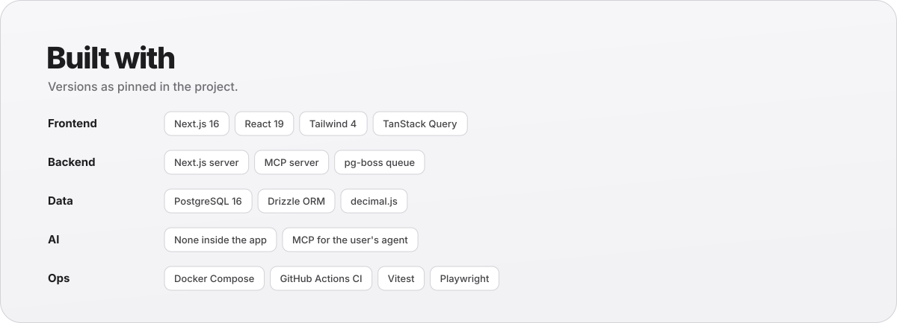
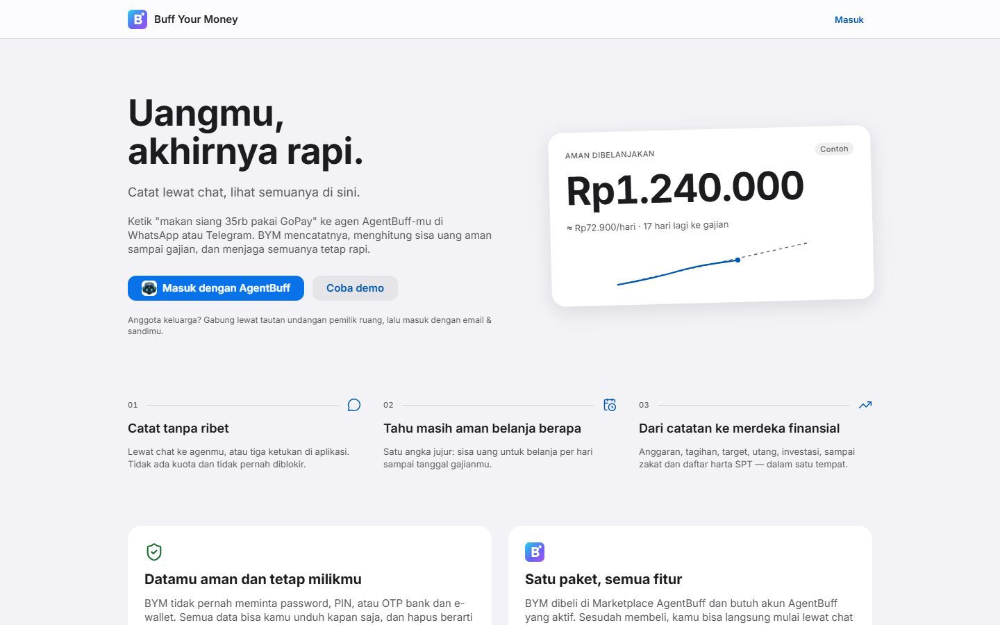

<!-- Showcase repository: the product is real and in use, its source code is private. -->

<a href="https://bym.agentbuff.id"><picture><source media="(prefers-color-scheme: dark)" srcset="assets/banner-dark.svg"></picture></a>

<a href="https://bym.agentbuff.id"><b>Open bym.agentbuff.id</b></a> · <a href="https://github.com/nugrahalabib">More of my work</a> · <a href="https://nugrahalabib.com">nugrahalabib.com</a> · <a href="mailto:nugrahalabib@gmail.com">Email</a>

## Overview

Buff Your Money is a web and phone app for personal and family finances. It is sold on the AgentBuff marketplace and connects to the user's own AI agent over MCP.

People stop tracking money because typing every expense is tedious. Here the user writes "lunch 35k with GoPay" to the agent in WhatsApp or Telegram, and the app records it.

There is no LLM inside the app. The agent does the language work. The app does parsing and money math deterministically, so a number is the same every time.

| | |
| --- | --- |
| **Status** | Live at [bym.agentbuff.id](https://bym.agentbuff.id) |
| **Role** | Designed and built by Nugraha Labib Mujaddid as a first-party app on the AgentBuff marketplace. |
| **Period** | Since Sep 2026 |
| **Source** | Private. This repository presents the product; the code is not published. |

<picture><source media="(prefers-color-scheme: dark)" srcset="assets/features-dark.svg"></picture>

Features as text

- **Quick entry by chat.** A deterministic parser reads amounts, dates and context from a short sentence and files the transaction.
- **Budgets and goals.** Monthly budgets, savings goals and a safe-to-spend figure until the next payday.
- **Debts and zakat.** Plan how to pay off debts, and calculate zakat from your own records.
- **Tax asset list.** Gather the assets and income figures needed for an annual tax return in one list.
- **Financial independence.** Simulate financial independence targets, including a Monte Carlo run on your own numbers.
- **Statement import.** Import bank statements from PDF and spreadsheet files, plus portfolio files, instead of typing them.
- **Family members.** Invite family members into a shared book, each with their own login.
- **Undoable agent actions.** Every action by the agent is logged, and the user can undo recent ones.

<picture><source media="(prefers-color-scheme: dark)" srcset="assets/architecture-dark.svg"></picture>

<picture><source media="(prefers-color-scheme: dark)" srcset="assets/stack-dark.svg"></picture>

## Engineering highlights

- Money is stored in minor units and calculated with a decimal library, never with floats.
- Row-level security and separate database roles for migration, app and worker.
- A deploy backs up first, then counts rows, and fails if any table shrinks.
- The app ships with a data protection impact assessment and an account deletion workflow.

## Screens

Landing page

---

Built by [Nugraha Labib Mujaddid](https://github.com/nugrahalabib). This page describes a private codebase; questions about the product or a demo are welcome at [nugrahalabib@gmail.com](mailto:nugrahalabib@gmail.com).
