<!-- Showcase repository: the product is real and in use, its source code is private. -->

<a href="https://bym.agentbuff.id"><picture><source media="(prefers-color-scheme: dark)" srcset="assets/banner-dark.svg"></picture></a>

<a href="https://bym.agentbuff.id"><b>Open bym.agentbuff.id</b></a> · <a href="https://github.com/nugrahalabib">More of my work</a> · <a href="https://nugrahalabib.com">nugrahalabib.com</a> · <a href="mailto:nugrahalabib@gmail.com">Email</a>

<a href="#the-business">The business</a> · <a href="#product-tour">Product tour</a> · <a href="#for-developers">For developers</a>

## Overview

Buff Your Money is a web and phone app for personal and family finances. It is sold on the AgentBuff marketplace and connects to the user's own AI agent over MCP.

People stop tracking money because typing every expense is tedious. Here the user writes "lunch 35k with GoPay" to the agent in WhatsApp or Telegram, and the app records it.

There is no LLM inside the app. The agent does the language work. The app does parsing and money math deterministically, so a number is the same every time.

| | |
| --- | --- |
| **Status** | Live at [bym.agentbuff.id](https://bym.agentbuff.id) |
| **Role** | Designed and built by Nugraha Labib Mujaddid as a first-party app on the AgentBuff marketplace. |
| **Period** | Since Sep 2026 |
| **Source** | Private. This repository presents the product; the code is not published. |

<picture><source media="(prefers-color-scheme: dark)" srcset="assets/features-dark.svg"></picture>

## The business

Buff Your Money (BYM) is a web and phone app for personal and family finances, sold on the AgentBuff marketplace and connected to the user's own AI agent over MCP. The user writes "makan siang 35rb pakai gopay" in WhatsApp or Telegram, and the agent records it in BYM. The app then shows where the money went, how much is safe to spend until payday, and the road from a first budget to financial independence, including Indonesian needs such as payday periods, arisan, THR, zakat and the asset list for the annual tax return. There is no LLM inside the app: parsing and money math are deterministic, so a number is the same every time. Nugraha Labib Mujaddid designed and built it as CEO of AgentBuff.

### The problem

People stop tracking money because logging every expense by hand is tedious and easy to forget. The product research cites a survey of 2,619 respondents in which 40.5% named the hassle of logging and 31% said they forget. Most money apps still ask the user to open the app and type each line.

The tools that do accept chat input tend to cap messages per month and offer only a thin dashboard, while full money apps lock basic features behind paywalls or show ads. Bank login sync in Indonesia is a licensed activity and is often missing or unreliable, so the numbers drift.

Local needs rarely live in one place: budgets that follow the payday instead of the calendar month, transfer and top up admin fees, paylater, arisan, THR and Lebaran, zakat, and the list of assets and debts for the annual tax return. Families also want one shared picture while each person keeps a private wallet.

Financial data is specific personal data under Indonesia's personal data protection law. Users are wary of apps that ask for bank passwords, and an AI agent that can change records needs a clear trail and a way back.

### Who uses it

| Role | What they do with it |
| --- | --- |
| **Owner** | Buys BYM on the AgentBuff marketplace and signs in with AgentBuff. Owns the household book, invites members, connects the agent and controls security, export and deletion. |
| **Manager** | A household member who records and edits shared transactions and sets budgets, goals, bills and rules, without access to member or space settings. |
| **Recorder** | Logs spending into shared wallets and sees budgets and their own records; can change only their own entries for 30 days. |
| **Viewer** | Sees shared balances, net worth and reports without changing anything. |
| **AI agent** | The user's AgentBuff agent in WhatsApp or Telegram. It records, answers questions with BYM's numbers, sets BYM up in chat, and can undo its own recent actions. |
| **Guest** | Tries the whole app in a guest demo filled with six months of a fictional family's finances, removed automatically after three hours. |

<picture><source media="(prefers-color-scheme: dark)" srcset="assets/before-after-dark.svg"></picture>

<picture><source media="(prefers-color-scheme: dark)" srcset="assets/journey-dark.svg"></picture>

<picture><source media="(prefers-color-scheme: dark)" srcset="assets/value-dark.svg"></picture>

### Model and status

BYM is a first-party app on the AgentBuff marketplace. Buying it requires an active AgentBuff account. It is one package with every feature: no ads, no paywall inside the app and no message quota, so recording is never blocked.

Some things are out of scope on purpose: logging in to banks or e-wallets, advice to buy or sell any financial product, rankings of financial products and bill payment. These are regulated activities in Indonesia, so BYM uses statement import instead of bank sync and describes the user's position without recommending products.

BYM was released on the marketplace on 1 October 2026 after a release gate of end-to-end proofs: purchase, sign-in, consent, recording from WhatsApp, freeze when access ends and recovery with data intact. A guest demo on the public site lets anyone try the app with fictional data.

## Product tour

### 1. Home and safe to spend

The home screen answers one question first: how much can I still spend until payday. Below it sit the payday ritual, the review inbox, rule-based insights, upcoming bills, budgets, goals, net worth and the Level Buff ladder.

- Safe-to-spend total and per day until the next payday, with a "where does this number come from" explanation
- Payday ritual that sets money aside for goals and bills before free spending
- Review inbox for imported or agent entries that need a category or wallet check
- Insights from rules, such as a newly detected subscription or the savings rate of the last period
- An eye button hides every amount on screen

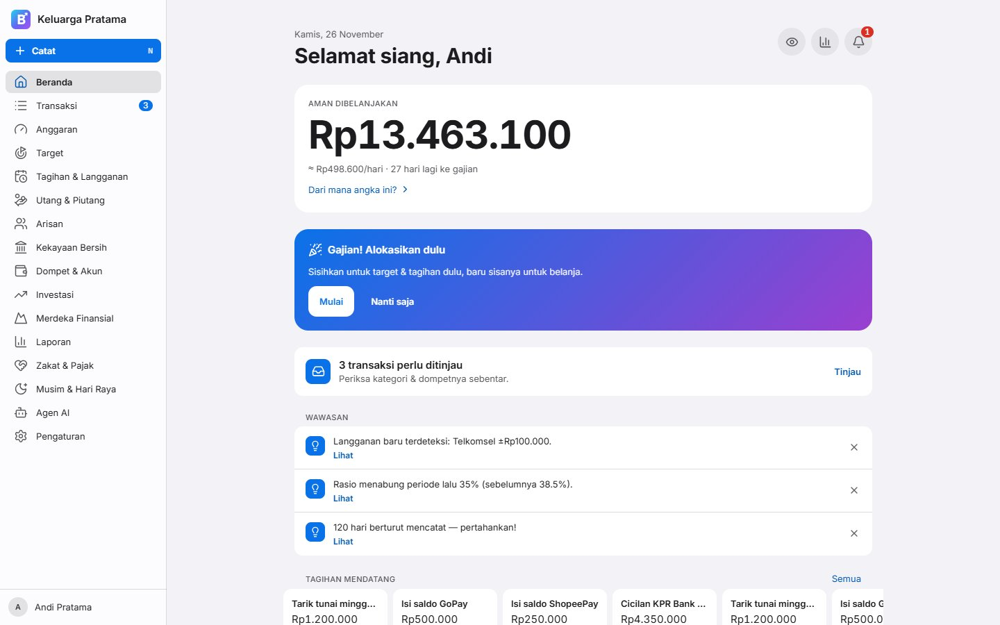

Home for the fictional Pratama family: safe to spend until payday, the payday ritual, review inbox and insights.

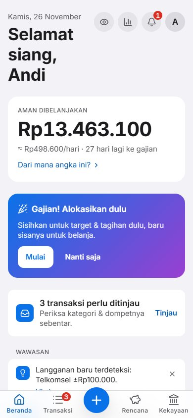

The same home screen on a phone, where most entries are reviewed.

### 2. Quick entry, wallets and transactions

Recording is one sentence. The same deterministic parser runs in the browser for the live preview and on the server for the record, so the app and the agent read a sentence the same way. Wallets cover cash, bank, e-wallet, credit card and asset accounts.

- Indonesian amount forms such as 25rb, 1,5jt, 2M for miliar, and slang like goceng, which asks for confirmation
- Several items in one line ("bensin 50rb, parkir 5rb cash") are saved together or not at all
- Transfers with an admin fee ("top up gopay 100rb dari bca admin 1000") become two linked legs plus the fee
- Split bills and borrowing always come back as a question instead of a guess
- Transaction list with search and filters for needs review, from agent and recently changed

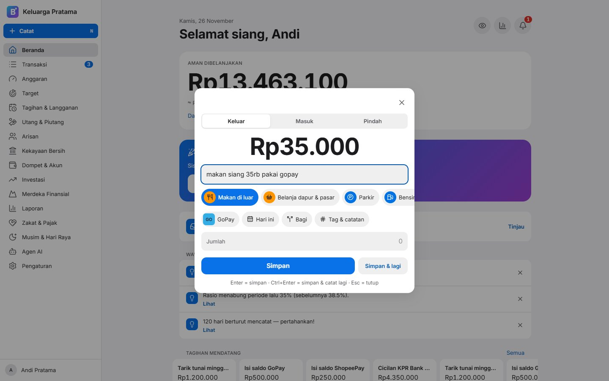

Quick entry reads "makan siang 35rb pakai gopay" as Rp35.000, Eating out, GoPay, today.

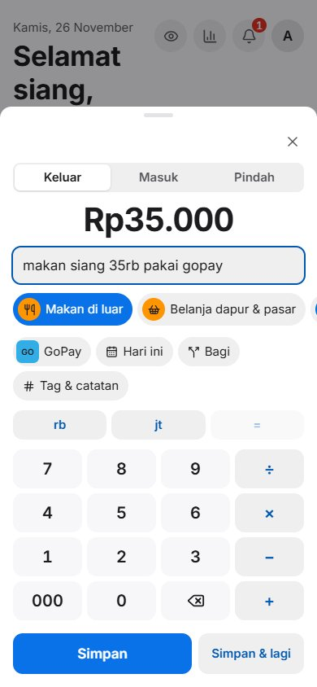 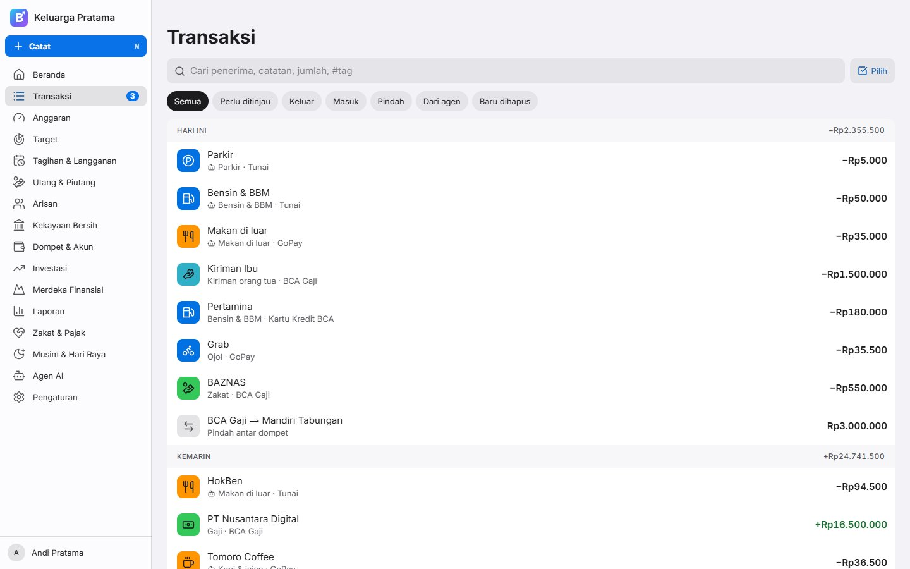

Left: Quick entry on a phone with frequent entries one tap away. · Right: Transactions grouped by day, with filters for review, agent entries and recent changes.

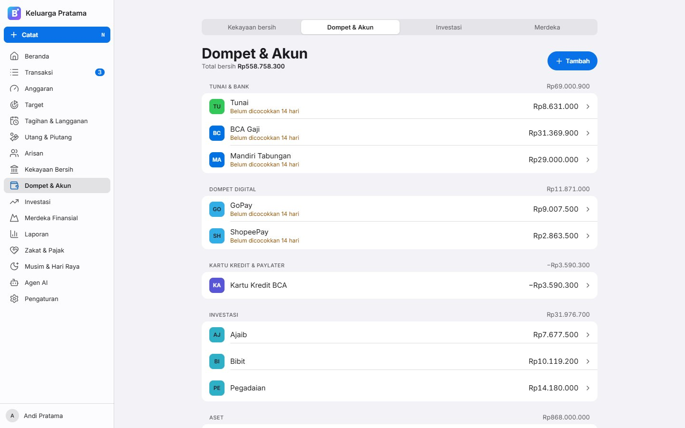

Wallets and accounts: cash, banks, e-wallets, credit card and investment accounts.

### 3. Budgets, goals and bills

Budgets follow the payday period and show a calm status per category instead of red warnings. Goals hold money in a dedicated wallet or a virtual pocket. Bills, subscriptions, salary and routine transfers are scheduled, and recurring spending is detected from history.

- Budget per category per period, with autofill, rebalance and moving funds between categories
- Status per category: safe, or predicted to overshoot at the current pace
- Goals with a projected completion date and the monthly amount needed to hit a deadline
- Bill and subscription schedule, plus suggestions when a payment looks recurring

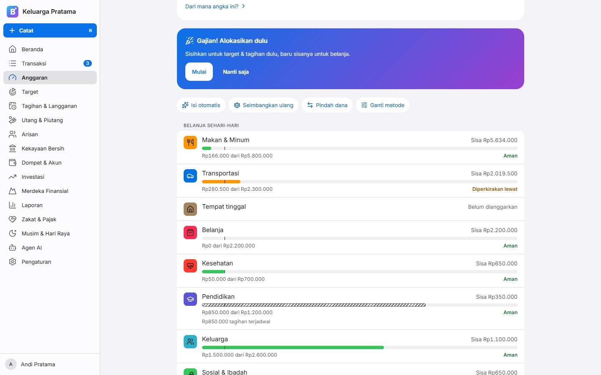

Budget for the current payday period with status per category.

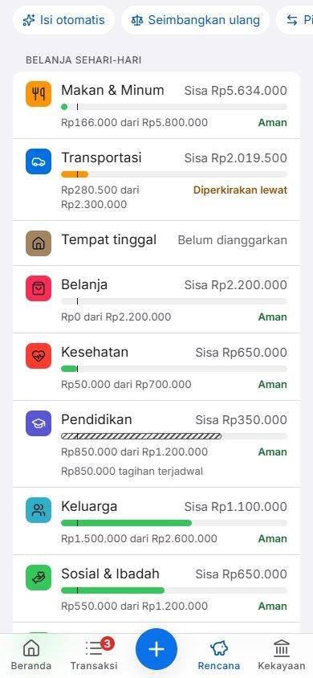 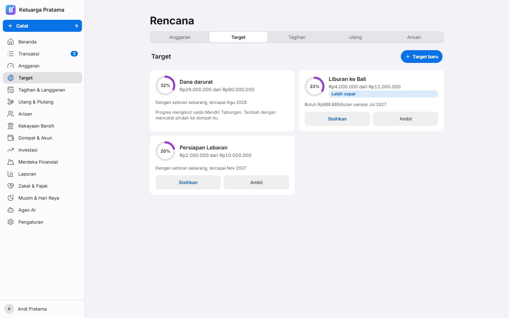

Left: Budget categories on a phone. · Right: Goals: emergency fund, a holiday and Lebaran, with projected dates.

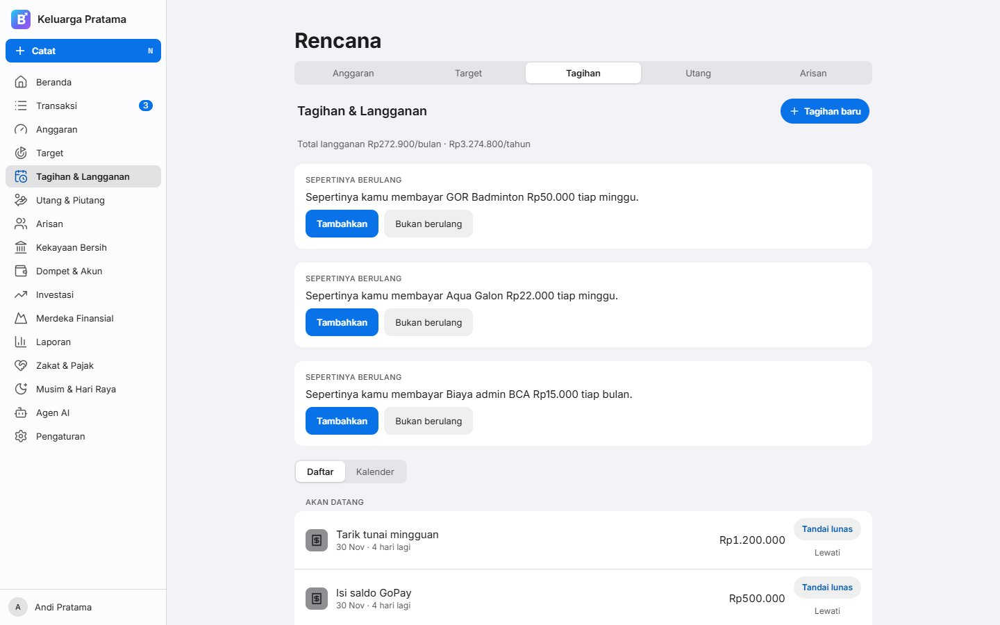

Bills and subscriptions, with suggestions for payments that look recurring.

### 4. Debts and payoff plan

Debts include mortgages, credit cards, paylater and personal loans, with payments split into principal and interest. A payoff simulator compares strategies, and arisan rounds are tracked in their own tab.

- Total debt, monthly installments and their share of income
- Payoff plan by avalanche, snowball or a custom order, with an extra monthly amount
- Payoff order and the month each debt is cleared
- Receivables for money lent to others, and arisan rounds with the user's turn

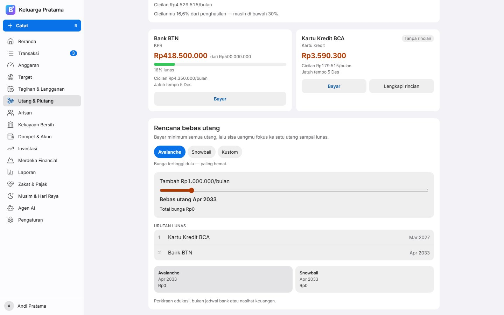

Debts with a mortgage and a credit card, and the payoff simulator with an extra monthly amount and the payoff order.

### 5. Net worth and investments

Net worth adds every wallet, investment and asset and subtracts debts, with a daily snapshot. Investments cover Indonesian shares, mutual funds, gold and more, with returns, allocation and risk statements. A printable wealth statement is one tap away.

- Net worth trend and what changed since the last period
- Holdings with XIRR and TWR returns, dividends and allocation against a target
- Risk statements for shares, crypto, P2P and paylater on screen and in agent answers
- Wealth statement for personal use, such as a mortgage or visa application

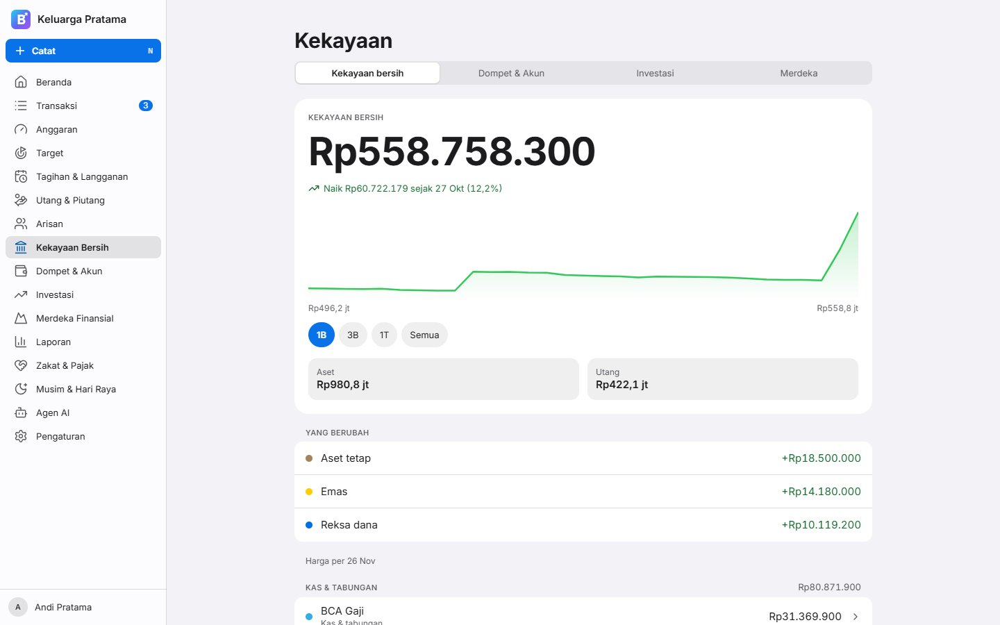

Net worth over time with the change by group.

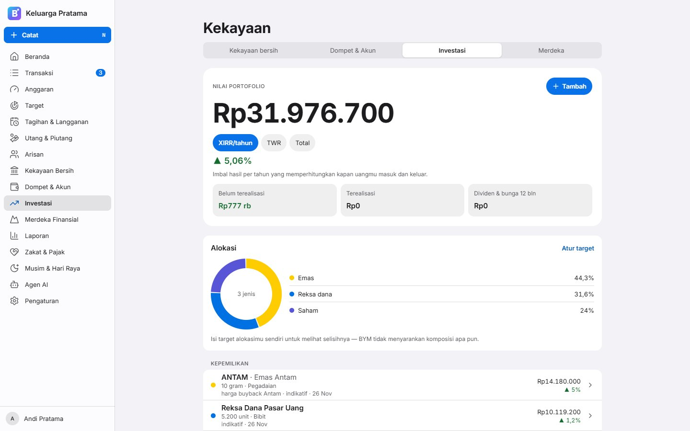 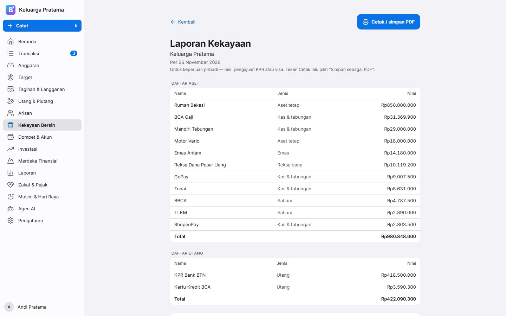

Left: Investment portfolio with return, allocation and holdings. · Right: Printable wealth statement listing assets and debts.

### 6. Financial independence

The Merdeka (financial independence) page turns the book into a long-term plan: the FI number, the projected year, Coast FI and three lifestyle versions. A Monte Carlo run shows the spread of outcomes next to the plan, and Level Buff ranks the household's financial health.

- FI number from yearly spending and a safe withdrawal rate the user can change
- Savings rate slider that moves the projected FI year
- Lean, comfortable and generous versions, plus Coast FI
- Monte Carlo with 1,000 trials and a P10 to P90 band, seeded so results repeat
- Level Buff ladder with nine levels, computed every night from the records

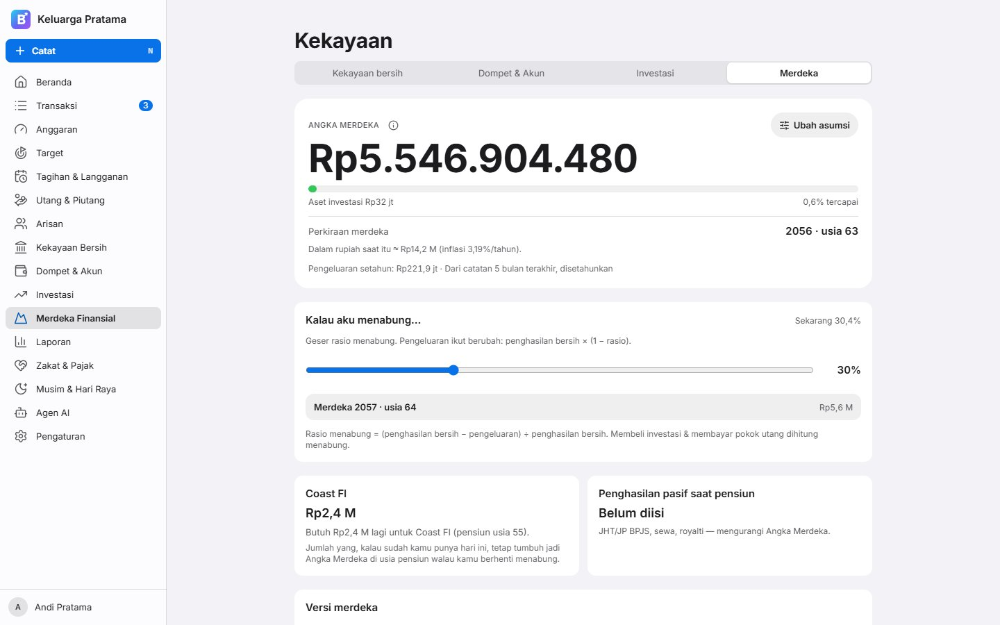

FI number, projected year, savings rate slider and Coast FI.

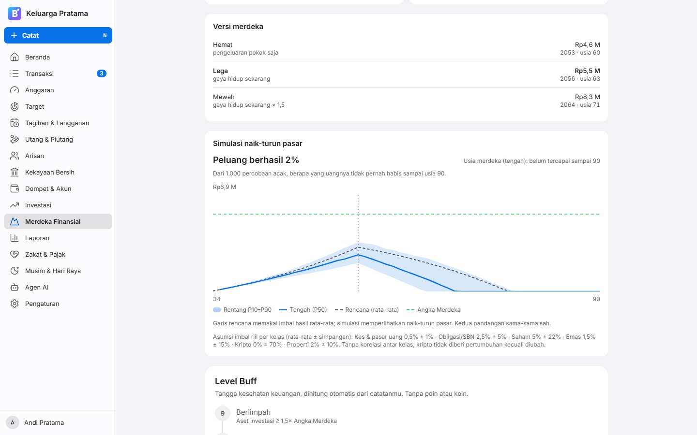

Monte Carlo band against the plan line, with the assumptions written out.

### 7. Zakat, tax list and seasons

BYM computes zakat from the user's own records and builds the asset and debt list for the annual tax return. A seasons page follows the Hijri calendar for THR, Lebaran and other yearly costs.

- Zakat on wealth with a nisab from a gold reference (brand, buyback or selling price) and haul tracking
- Zakat on income, gross or net, plus zakat fitrah and fidyah
- Tax-return list of assets and debts as of 31 December with codes, year and cost of acquisition, ready to copy or download
- THR estimate by length of service, an allocation plan and a Lebaran goal

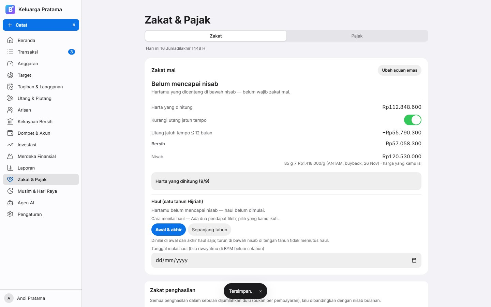

Zakat on wealth: assets counted from the book, debts due deducted, and the result compared with a nisab of 85 grams of gold.

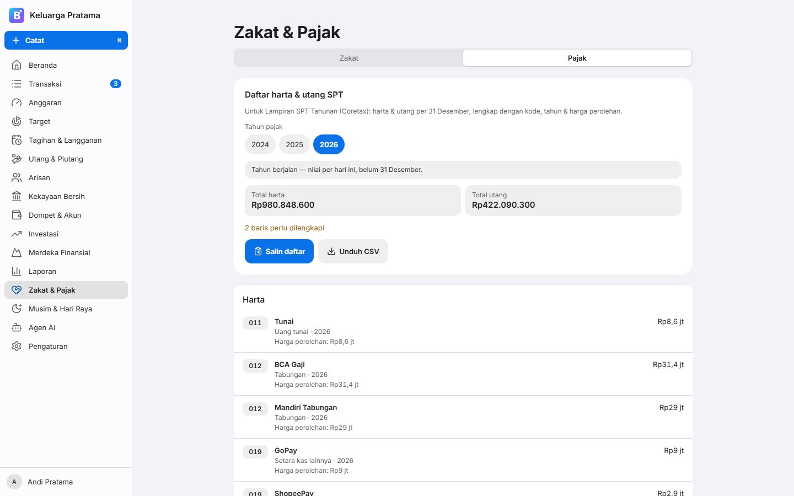 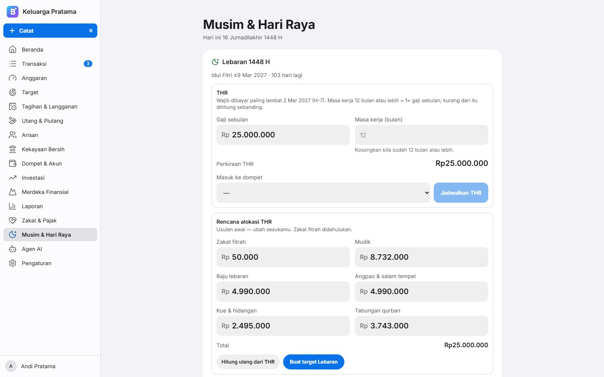

Left: Asset and debt list for the annual tax return, with tax codes, year and cost of acquisition, ready to copy or download as CSV. · Right: Seasons page with the THR estimate and a Lebaran allocation plan.

### 8. Import, export and reports

Instead of bank login, users import statements. Files are read on the device, shown as a preview, and saved as one batch that can be cancelled and undone. Reports cover cash flow, categories, trends and a year in review, and PDF reports are laid out for reading on a phone.

- KlikBCA and BRImo CSV, Livin' by Mandiri XLSX, BCA and Mandiri PDF, generic CSV or Excel, and exports from other money apps
- Format detection, manual column mapping and duplicate detection before saving
- Portfolio import from the KSEI AKSes statement or broker files
- Full ZIP export and restore
- Daily, weekly and monthly PDF reports in A5 portrait, answer first and details after

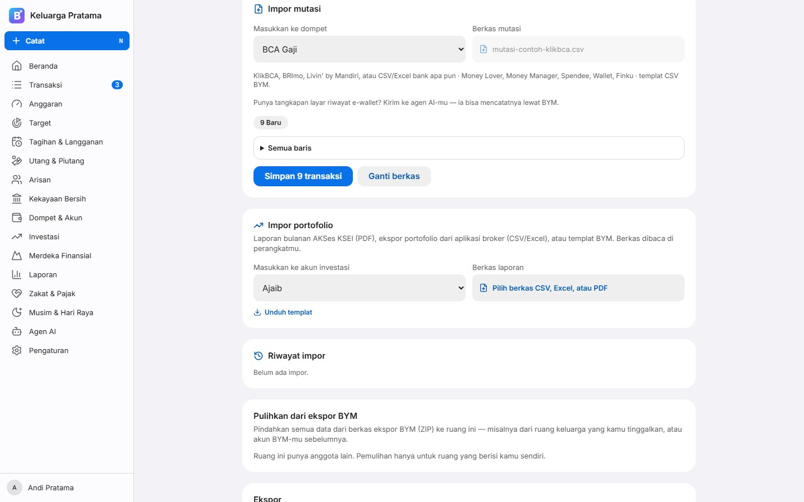

A sample KlikBCA statement detected, read on the device and checked: nine new rows ready to save.

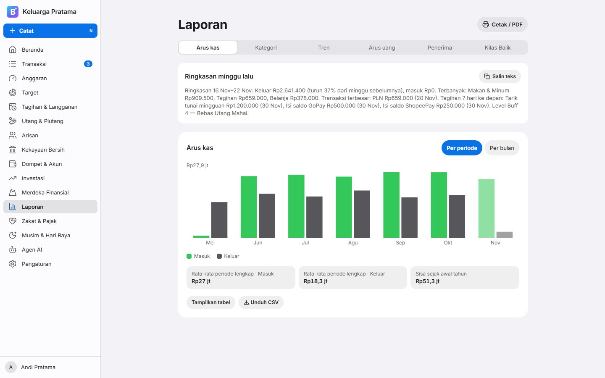 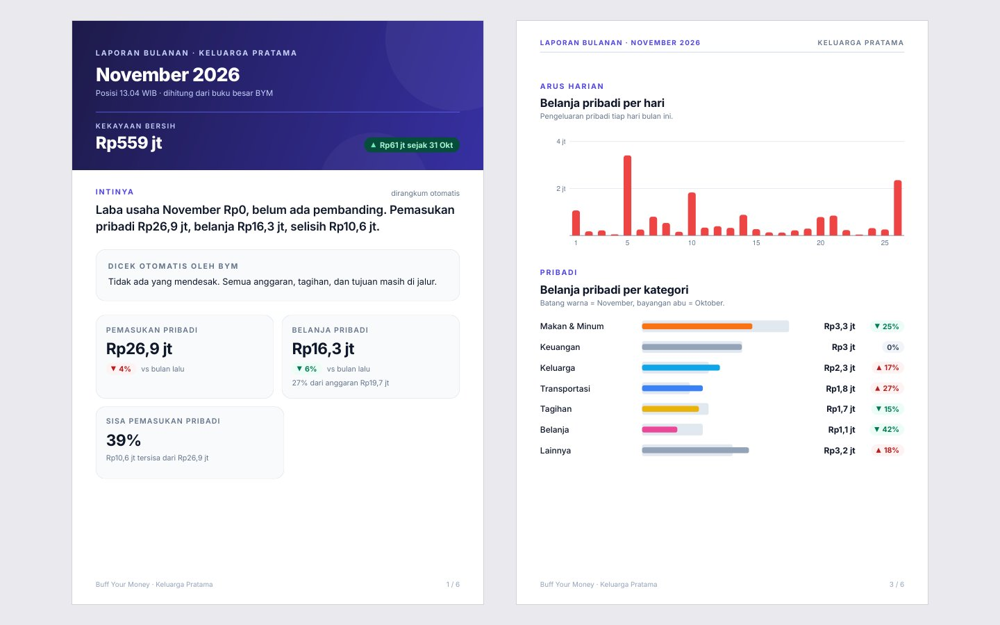

Left: Cash flow report with a weekly summary the user can copy. · Right: Two pages of the monthly PDF report, rendered from the local run.

### 9. Agent AI and household

The Agent AI page is where people see and control what their agent did. Every agent action of the last 30 days is listed with Undo and View. The household page manages members, roles and invitations, while private wallets stay private.

- Auto-connect from AgentBuff, or a manual token with read or read and record scope
- Agent activity for 30 days with Undo per action; undone actions are struck through
- Token list with last use and revoke
- Roles: owner, manager, recorder, viewer; up to six people per book
- Each member decides whether their records reach the agent

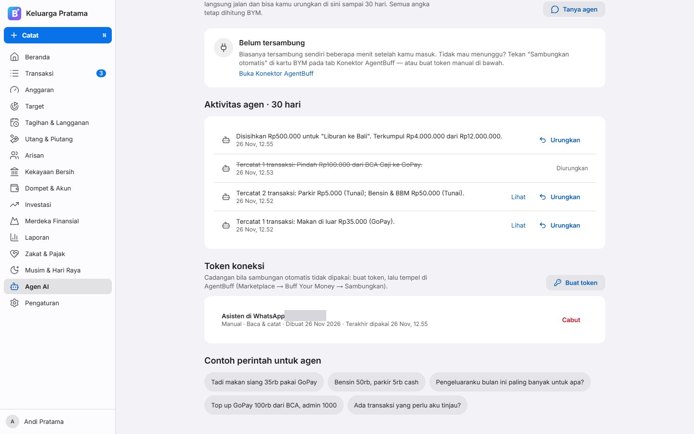

Agent activity after MCP calls made in the local run: the transfer was undone and is struck through; the token prefix is masked.

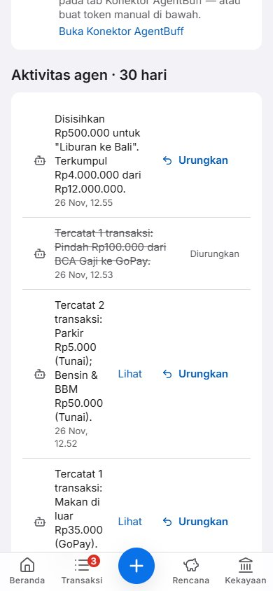 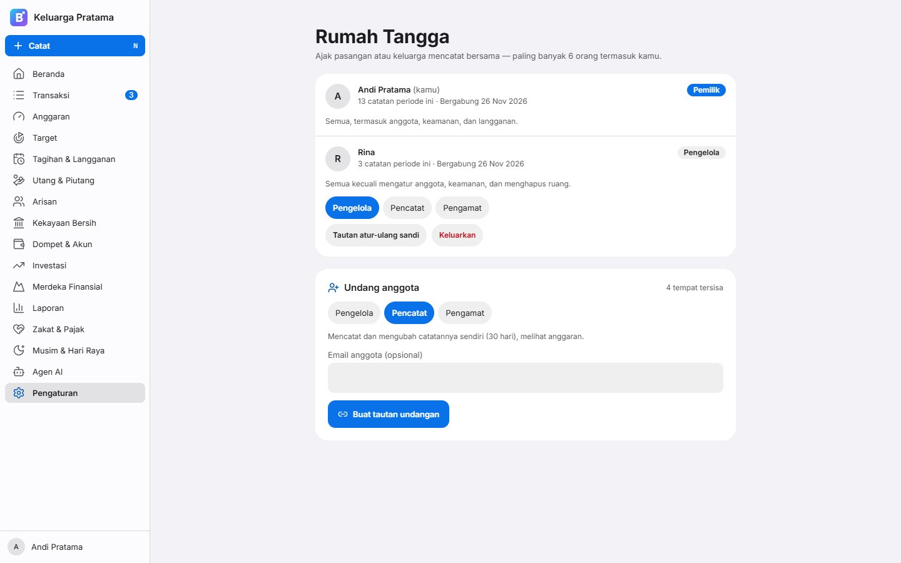

Left: Agent activity with Undo buttons on a phone. · Right: Household members with roles and an invitation form.

## For developers

### Architecture

BYM is one Next.js 16 app (React 19, TypeScript, Tailwind 4) with PostgreSQL 16 and a background worker built from the same image. The web process serves the app pages, a JSON API for the app, the MCP endpoint and the endpoint AgentBuff calls to connect an agent. The worker runs scheduled jobs with pg-boss in the same database. Drizzle ORM handles the schema, and migrations are additive only.

The MCP server uses the official SDK over Streamable HTTP, stateless, with JSON responses. Authentication runs before any JSON-RPC is parsed: a wrong or revoked token gets HTTP 401 even for initialize and tools/list, so a connection test can never report a false success. tools/list returns only what the token may use: read and compute tools for a read token, record tools for a record token, and deletions and bulk changes only when the token carries that extra permission. A full-scope token lists 109 tools covering accounts, transactions, budgets and goals, bills, debts and arisan, net worth and investments, FI, zakat and tax, seasons, reports, files and import, members and settings.

Tool and parameter names are English snake_case with Indonesian examples in the descriptions. Money goes in as a major-unit amount and comes out as amount, currency and display text. Each result carries structured content and an Indonesian summary of up to 2,000 characters that the agent can read out. Every write needs a client_ref: the same reference with the same arguments returns the stored result marked as a duplicate, and with different arguments it is an error. The server instructions tell the agent never to compute numbers itself, to ask the user when a tool returns needs_clarification, and never to recommend buying or selling financial products.

There is no LLM inside BYM. The quick entry parser, insights and category suggestions are rules. Money is stored as integers in minor units and calculated with decimal.js in pure modules for budgets, safe to spend, debts, FI, Monte Carlo, zakat, tax list and net worth; a build guard rejects floating point money code.

Side effects are approved in chat, with undo as the safety net. Since 1 October 2026 the user's chat command counts as approval: record tools run at once, and deletions and bulk changes run only with the extra token permission. Every agent write is stored as an action with the state before and after, and can be undone for 30 days from the Agent AI page or by the same agent within 24 hours. Undo refuses when the record was changed again after the action. Bulk changes support dry_run so the agent can show a preview and confirm first, and an earlier flow where agents created drafts for approval in the app still resolves old drafts.

Sign in uses "Sign in with AgentBuff": OpenID Connect with authorization code and PKCE, an ES256 ID token and a stable per-app subject. The owner's entitlement is checked at every entry point with a 10 minute cache and strictly at sign-in. Only a clear answer that access ended freezes the book; an AgentBuff outage is tolerated for 72 hours, and a circuit breaker holds freezes when too many owners flip at once. A frozen book keeps its data, and agent calls receive an error with a renewal link.

<picture><source media="(prefers-color-scheme: dark)" srcset="assets/architecture-dark.svg">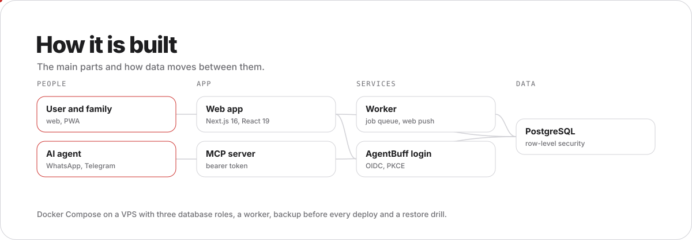</picture>

### Data model

<picture><source media="(prefers-color-scheme: dark)" srcset="assets/data-model-dark.svg"></picture>

### Key flows

<picture><source media="(prefers-color-scheme: dark)" srcset="assets/flow-1-dark.svg"></picture>

<picture><source media="(prefers-color-scheme: dark)" srcset="assets/flow-2-dark.svg"></picture>

<picture><source media="(prefers-color-scheme: dark)" srcset="assets/flow-3-dark.svg"></picture>

<picture><source media="(prefers-color-scheme: dark)" srcset="assets/flow-4-dark.svg"></picture>

<picture><source media="(prefers-color-scheme: dark)" srcset="assets/flow-5-dark.svg"></picture>

<picture><source media="(prefers-color-scheme: dark)" srcset="assets/flow-6-dark.svg"></picture>

### Security

- Row level security is enabled and forced on every table with a space id, with separate policies for reading and writing keyed to a per-transaction setting.
- The database has separate roles for migrations, the web app and the worker; none is a superuser or bypasses row level security, so even the table owner is filtered.
- A build guard fails if a table with a space id lacks row level security or its policies, and each deploy runs an RLS gate with 101 assertions.
- A member's private wallets are hidden from everyone else, including the space owner, and appear in household totals only as one line when the member opts in.
- MCP tokens and session ids are random and stored only as SHA-256 hashes; a manual token is shown once.
- The session cookie is host-only, httpOnly, Secure and SameSite Lax, and every mutation requires a same-origin request.
- Member passwords and the app PIN are hashed with argon2id, and repeated wrong PINs lock the app.
- Receipt photos and uploaded files are encrypted with AES-256-GCM using a per-file key wrapped by a master key, with the record bound as associated data.
- A nonce-based Content Security Policy is set per request, connections are limited to the app itself, framing is denied and all libraries are self-hosted.
- BYM never asks for bank, e-wallet or OTP credentials, and password-protected statements are opened on the device.
- MCP calls are rate limited per token: 120 calls and 30 writes per minute.
- Logs never contain amounts, notes or tokens; internal errors return only an error id.
- A data protection impact assessment, an incident runbook and a privacy policy that covers agent access were completed before release.

### Quality

- 572 Vitest tests passed at release on 1 October 2026, including golden examples for every money formula and the parser cases.
- Property tests with fast-check cover ledger, period, investment and delete then undo invariants.
- Integration tests run on PGlite (PostgreSQL in WebAssembly), including an MCP contract test and a row level security gate.
- Release proofs on the live system with throwaway accounts passed: purchase to recovery 18 of 18, MCP 45 of 45, guest demo 52 of 52, screen reader flows 29 of 29.
- axe found 0 serious or critical violations across 32 pages in light and dark themes, with no horizontal scroll at 320 px.
- On five main pages with 4x CPU throttling, LCP was 1.03 to 1.65 s and JavaScript 267 to 276 KB.
- A scale test with 50,000 transactions in one space loads the first page of the transaction list in 17 ms on PGlite and checks query plans for full scans.
- CI runs the guard script with its own self-tests, TypeScript, lint, the test suite and a production build.

### Deployment and operations

Docker Compose with three containers: PostgreSQL 16, the web app as a Next.js standalone server, and the worker from the same image, on an internal network with no published ports behind a reverse proxy with TLS.

The app refuses to start when a required environment variable is missing, and never prints the values.

One deploy script runs a verified database backup, a row count per table, the build, additive migrations, the RLS gate, a health check and a recount, and fails if any table shrank.

Database dumps run every 6 hours and are kept 14 days; a restore drill passed with identical rows across 62 tables.

A health endpoint reports the database, the queue and the worker heartbeat, and an operator page shows job status.

Worker jobs post recurring items, send reminders that respect quiet hours, refresh prices and exchange rates, snapshot net worth nightly, compute insights and Level Buff, send a weekly summary and run cleanup and scheduled deletions.

Guest demos are capped at 300 at the same time and removed by the worker when the session ends.

### Decisions

| Decision | Why |
| --- | --- |
| No LLM inside the app | The user's own agent does the language work and BYM does deterministic parsing and math. Numbers are repeatable and testable, and the agent is told to call a tool instead of computing. |
| Chat approval with a 30 day undo | An earlier draft-and-approve flow forced users back into the app. Logging every agent change with its previous state keeps chat fast and every mistake reversible. |
| Statement import instead of bank sync | Bank and e-wallet login sync is a licensed activity and unreliable. Import with a preview keeps the user in control and never touches bank credentials. |
| Integer money in pure modules | Minor units with decimal.js avoid rounding drift, and pure functions let every formula carry a golden-example test. |
| Two layers of tenant isolation | Every query runs through a helper that sets the space context, and PostgreSQL row level security enforces it again, so one missed filter cannot leak another family's data. |
| Seeded Monte Carlo | The same seeded module runs in a browser Web Worker and in server tests, so a simulation result repeats exactly. |
| Reject bad tokens before JSON-RPC | AgentBuff judges a connection by initialize and tools/list; answering 401 up front prevents an empty but successful handshake. |
| Self-hosted libraries under a strict CSP | With connections limited to the app itself, pdf.js and other assets are served locally so imports keep working with the production policy on. |

### Built with

<picture><source media="(prefers-color-scheme: dark)" srcset="assets/stack-dark.svg"></picture>

### Engineering highlights

- Money is stored in minor units and calculated with a decimal library, never with floats.
- Row-level security and separate database roles for migration, app and worker.
- A deploy backs up first, then counts rows, and fails if any table shrinks.
- The app ships with a data protection impact assessment and an account deletion workflow.

---

Built by [Nugraha Labib Mujaddid](https://github.com/nugrahalabib). This page describes a private codebase; questions about the product or a demo are welcome at [nugrahalabib@gmail.com](mailto:nugrahalabib@gmail.com).

## Related

- [AgentBuff](https://github.com/nugrahalabib/agentbuff-showcase)
- [Smart Home for AgentBuff](https://github.com/nugrahalabib/agentbuff-tuya-showcase)
- [FinFreedom](https://github.com/nugrahalabib/FinFreedom)
- [All my work on GitHub](https://github.com/nugrahalabib)
